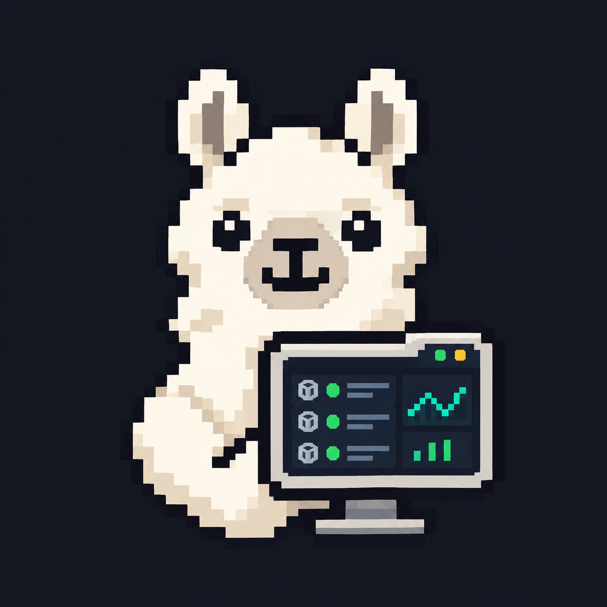

# Ollama 推理监控台 | Ollama Inference Monitor


[](https://github.com/DearCrazyLeaf/ollama_monitor/releases)
[](LICENSE)
[](https://github.com/DearCrazyLeaf/ollama_monitor/issues)
[](https://github.com/DearCrazyLeaf/ollama_monitor/pulls)
[](https://github.com/DearCrazyLeaf/ollama_monitor/stargazers)


---

## ✨ 简介 | Introduction

<table>
  <tr>
    <td width="190" align="center">
      
    </td>
    <td>
      <strong>Ollama Inference Monitor</strong><br />
      Passive API proxy + GPU telemetry + real-time SSE inspection<br />
      <sub>A lightweight FastAPI console that proxies Ollama /v1 traffic and visualizes GPU + model I/O without probing upstream on idle.</sub>
    </td>
  </tr>
</table>

---

## ✨ 功能列表 | Features

- **GPU 实时遥测**：调用 `nvidia-smi`，显示 GPU 利用率、显存使用/占比、温度、功耗、核心/显存频率，附带最近 90 秒的利用率与显存历史曲线，以及进程级显存列表
- **Ollama API 请求捕获**：截获并展示实际发送到 Ollama 的 `/v1/chat/completions`、`/v1/completions`、`/v1/responses` 请求 JSON（messages、tools、参数等）
- **流式响应监控**：逐段解析 OpenAI 兼容的 SSE 输出，实时显示模型传出内容、`reasoning` / `reasoning_content` / `thinking` 字段，以及工具调用增量
- **WebSocket 实时推送**：通过 `/ws` 推送新增请求、内容增量、结束状态与 Token 用量到所有浏览器客户端
- **被动监控模式**：启动时不探测、不连接、不启动 Ollama；仅在收到实际 `/v1` 请求时转发
- **内存记录**：所有捕获内容仅保存在运行内存中，5 分钟滚动记录（最多 40 条），程序退出后清空；`Base64` 图像内容在面板中隐藏
- **多模型通用**：不绑定任何特定模型名称，适用于任意通过 Ollama OpenAI 兼容 API 调用的模型

---

## 🖼️ 效果展示 | Screenshots

访问 `http://127.0.0.1:11435/` 后即可看到以下布局：

| 区域 | 说明 |
|------|------|
| **GPU 硬件监控** | 实时利用率、显存、温度、功耗、频率 + 90 秒历史曲线 + 进程列表 |
| **请求记录** | 左侧时间轴，显示每一条经过代理的 API 请求 |
| **详情面板** | 右侧展示所选请求的完整 JSON、模型思考内容、流式输出及工具调用 |

---

## 📥 安装 | Installation

### 环境要求 | Requirements

- **操作系统**：Windows 10/11（其他系统需自行调整防火墙规则）
- **Python**：3.10 或更高版本
- **NVIDIA GPU**：需安装 NVIDIA 驱动（`nvidia-smi` 可在 PowerShell 中运行）
- **Ollama**：已在本地 11434 端口正常运行

### 安装步骤 | Steps

将项目克隆到本地，或直接下载本文件夹到任意目录：

```bash
git clone https://github.com/DearCrazyLeaf/ollama_monitor.git
```

创建虚拟环境并安装依赖：

```bash
cd ollama_monitor
python -m venv .venv
.venv\Scripts\python.exe -m pip install -r requirements.txt
```

Windows 用户可以直接双击 `start_monitor.bat` 启动（首次运行会自动创建虚拟环境并安装依赖）。

---

## ⚙️ 配置 | Configuration

监控台通过环境变量可选配置运行参数，详情见 `app.py` 文件顶部常量：

| 参数 | 默认值 | 说明 |
|------|--------|------|
| `OLLAMA_UPSTREAM` | `http://127.0.0.1:11434` | Ollama 上游地址，一般保持默认 |
| `LISTEN_HOST` | `0.0.0.0` | 监听地址，`0.0.0.0` 表示允许局域网访问 |
| `LISTEN_PORT` | `11435` | 监听端口，**OpenAPI 配置中的 Web 端口也必须填写为 11435** |
| `MAX_EVENTS` | `40` | 内存中最多保留的请求记录数 |
| `MAX_CAPTURE_CHARS` | `250_000` | 单条内容最大显示字符数 |

> **公网或跨设备访问**：默认 `LISTEN_HOST` 为 `0.0.0.0` 已允许局域网访问；如需通过公网 IP 访问面板，请自行做好安全防护，并在浏览器中访问 `http://<公网 IP>:11435/`。

### 在 AstrBot 中配置代理 | Configure AstrBot

在 AstrBot 的 Ollama 提供商中，仅需将 **API Base URL** 的端口改为代理端口：

| 项目 | 原始（直连） | 修改为（经过监控台） |
|------|--------------------|------------------------|
| API Base URL | `http://<Ollama 主机 IP>:11434/v1` | `http://<Ollama 主机 IP>:11435/v1` |
| API Key | `ollama` | `ollama`（保持不变） |
| 模型 ID | （任意模型，如 qwen、llama、gemma 等） | 保持不变 |

---

## 📖 使用说明 | Usage

1. 保持监控台运行

   ```bash
   .venv\Scripts\python.exe app.py
   ```

   或双击 `start_monitor.bat`。

2. 在 Ollama 主机的浏览器打开监控面板：`http://127.0.0.1:11435/`，检查 GPU 区域是否有数据

3. 修改 AstrBot 的 Ollama 提供商 API Base URL 为 `http://<Ollama 主机 IP>:11435/v1`，然后在 AstrBot 插件页面执行模型测试

4. 面板“请求记录”中将出现新请求，点击即可查看：
   - **收到的请求**：实际发送到 Ollama 的完整 JSON
   - **模型思考 / reasoning 字段**：模型输出的 `reasoning` / `reasoning_content` / `thinking` 内容
   - **模型传出内容 / content**：解析后的文本流（` thinking ` 标记会被自动分离）
   - **原始 content 流**：包含 ` thinking ` 标记的原始流
   - **工具调用增量**：函数调用的 diff 内容
   - **Token 用量**：流结束后的 `usage` 统计

5. 触发一次 `code_developer` 等实际任务，观察面板是否连续出现多轮请求和工具调用

---

## 🛠️ 问题排查 | Troubleshooting

- **GPU 区域无数据**：确认 `nvidia-smi` 在 PowerShell 中可正常运行；若为笔记本电脑，请在 NVIDIA 控制面板中设置偏好 GPU
- **进程列表为空或 N/A**：在 Windows WDDM 模式下，`nvidia-smi` 可能无法提供进程级显存列表；GPU 总利用率和显存图仍可正常使用
- **面板未显示请求记录**：确认 AstrBot 的 API Base URL 已改为 `:11435/v1`，且 Ollama 主机防火墙已放行 11435 端口
- **跨设备访问失败**：在 Ollama 主机的管理员 PowerShell 执行防火墙放行规则：

  ```powershell
  New-NetFirewallRule -DisplayName "Ollama-Monitor-Proxy" -Direction Inbound -Action Allow -Protocol TCP -LocalPort 11435 -RemoteAddress "<AstrBot 主机 IP>" -Profile Private
  ```

- **"无法连接本机 Ollama"（502）**：确认 Ollama 服务正在运行且监听在 `127.0.0.1:11434`，可运行 `ollama serve` 启动

---

## 📜 许可证 | License

[](https://www.gnu.org/licenses/gpl-3.0.txt)

本项目基于 **GNU General Public License v3.0** 开源；详见 [LICENSE](LICENSE)。

## ❤️ 贡献者 | Contributors

<a href="https://github.com/DearCrazyLeaf/ollama_monitor/graphs/contributors">
  
</a>

---

> Made for AstrBot ❤️
